#### 通用-General

#### 声音-Sound

 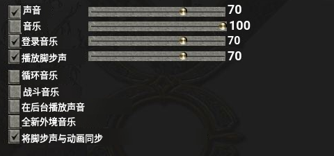

#### 显示-Video

 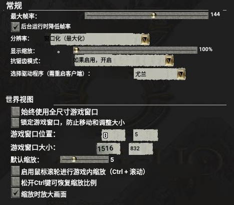

 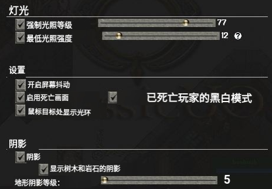

#### 宏-Macros

 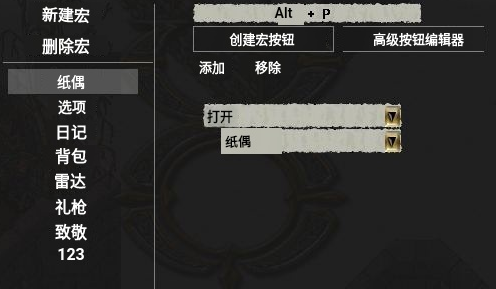

#### 提示框-Tooltip 

 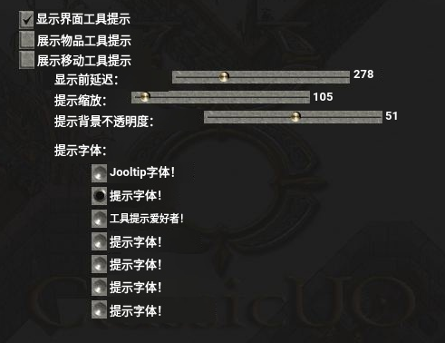

#### 字体-Fonts  

 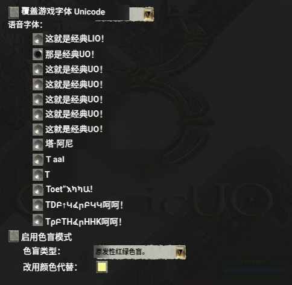

#### 演讲-Speech   

 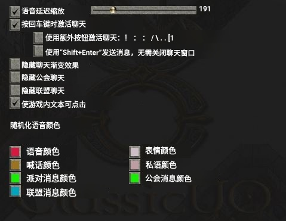

#### 战斗法术-Combat-Spells

 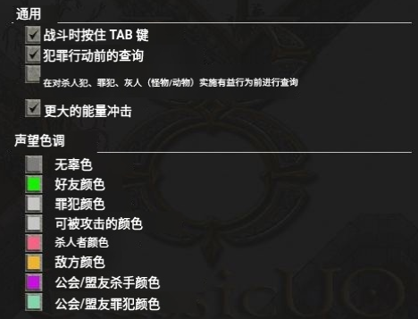

 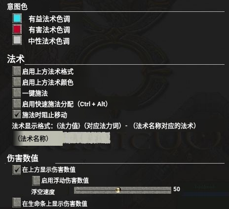

#### 计数器-Counters

 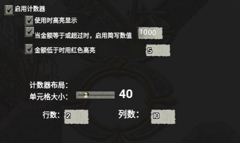

#### 信息栏-Info Bar

 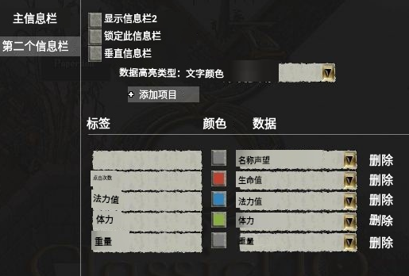

#### 界面-Interface
 
 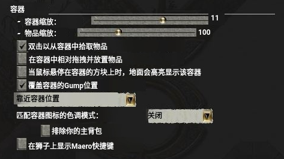

 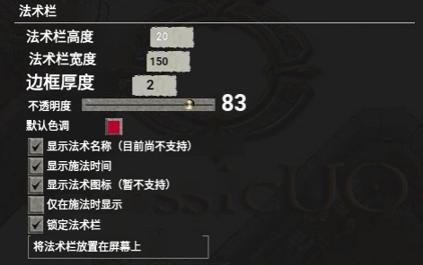

 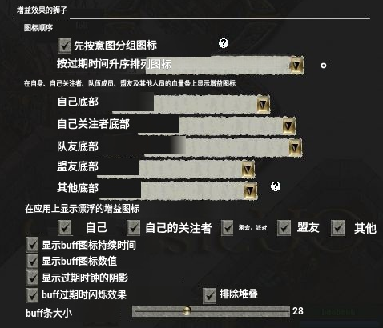

 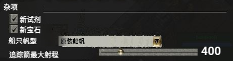

#### 实验性-Exprimental

 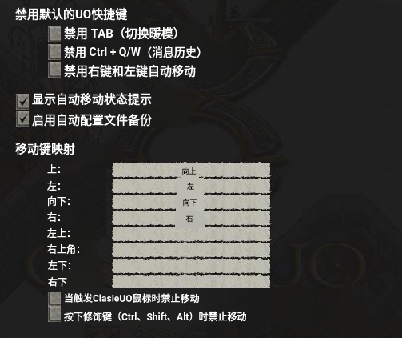

#### 窗口管理-Window Manager

 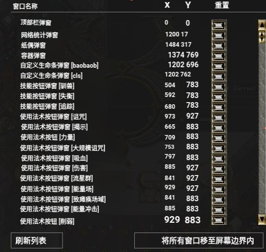

#### 名字显示-Nameplates

 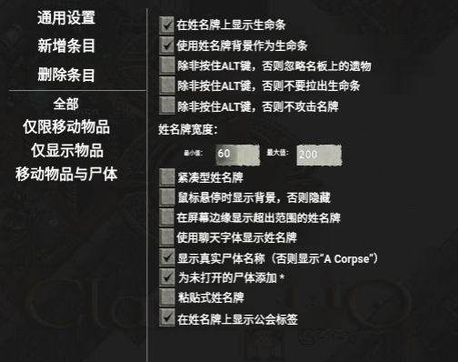

#### 冷却时间-Cooldowanw

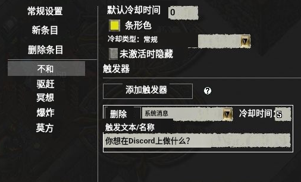

 

 

 

